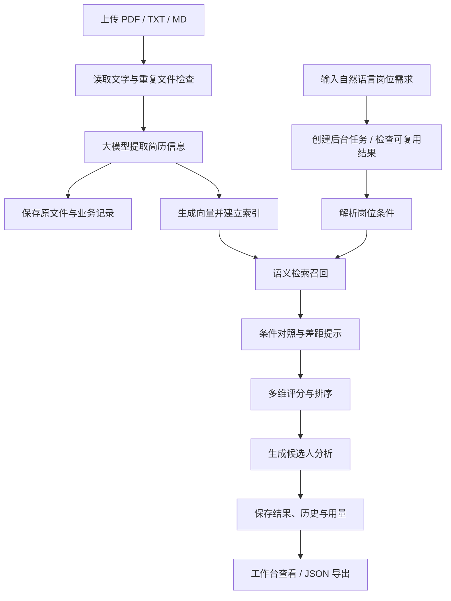

<div align="center">


# 拾才 · 智能招聘工作台

**让人才与机会相遇**

基于大语言模型与向量检索的简历筛选 Agent 应用。
从上传简历、理解岗位，到候选人匹配与分析，在一个工作台中完成。

**Python · FastAPI · LangChain · ChromaDB · SQLite · 智谱 BigModel**

[项目介绍](#项目介绍) · [功能特性](#功能特性) · [快速开始](#快速开始) · [处理流程](#处理流程) · [常见问题](#常见问题) · [项目来源与致谢](#项目来源与致谢)

</div>

---

## 项目介绍

拾才是一款面向招聘初筛场景的本地 Web 应用。用户上传简历后，可以用自然语言描述岗位需求；系统结合大模型解析、语义检索、条件对照与多维评分，生成候选人排序和匹配分析，辅助人工复核。

例如：

> 寻找一位有 3 年以上经验的 Python 后端工程师，熟悉 FastAPI 和 SQL，本科及以上，可在北京工作。有 Docker 实践经验优先。

本项目基于 [LLM-Agent-Resume](https://github.com/liangdabiao/LLM-Agent-Resume) 二次开发，在原有筛选流程上，完善了工作台界面、数据持久化、后台任务、历史记录、简历原件管理和回收站等功能。

**界面设计与项目定制：闫思旭。**

## 功能特性

| 模块 | 已实现能力 |
| --- | --- |
| 简历上传 | 支持文字版 PDF、TXT、MD，单文件最大 10 MB；支持选择文件与拖拽上传 |
| 信息提取 | 从简历中提取姓名、技能、教育、工作和项目经历等结构化信息 |
| 岗位理解 | 将自然语言岗位描述转换为查询条件，提供常用岗位模板 |
| 语义检索 | 使用向量检索召回相关简历，以岗位条件检查生成待核实提示，宽松保留部分匹配者 |
| 评分与分析 | 按多个维度计算匹配分数、排序，并生成候选人分析报告 |
| 后台任务 | 展示处理阶段与耗时；页面刷新后可继续查询任务状态 |
| 历史记录 | 保存筛选记录与结果，失败或中断后支持手动重试 |
| 重复请求复用 | 相同文件复用解析结果；相同岗位、资料库及模型配置下可复用已完成任务 |
| 简历查看与下载 | 查看提取文字；保存了 PDF 原件的记录可预览和下载原件 |
| PDF 导出 | 没有 PDF 原件时，根据提取文字生成明确标注的“文字重建版” |
| 本地回收站 | 简历可移入回收站、恢复，或在再次确认后永久删除 |
| 用量统计 | 记录服务商返回的 Token 用量，并根据配置单价估算费用 |
| 结果导出 | 将筛选结果导出为 JSON，便于保存和后续处理 |
| 工作台界面 | 蓝紫与雾白配色，配合“聚焦之星”标识、资料搜索与结果排序 |

> 当前版本面向本机、单进程使用。匹配分数属于系统规则评分，不代表录用概率；候选人分析应由招聘人员结合原始简历复核。

## 处理流程



系统采用围绕招聘任务编排的处理流程：模型负责理解与分析，程序负责检索、过滤、评分、任务状态与文件管理。

### 评分维度

当前综合评分由以下规则加权计算，具体实现见 [`app/core/scorer.py`](app/core/scorer.py)。

| 维度 | 权重 |
| --- | ---: |
| 技能匹配 | 30% |
| 行业匹配 | 20% |
| 地点匹配 | 20% |
| 薪资匹配 | 10% |
| 学历匹配 | 10% |
| 标签匹配 | 10% |

## 技术栈

| 层次 | 技术与用途 |
| --- | --- |
| Web 服务 | FastAPI、Uvicorn：提供 HTTP 接口、接口文档和静态页面 |
| 模型接入 | LangChain、OpenAI 兼容接口：组织模型请求与响应 |
| 对话与分析 | 智谱 `glm-5.3-flash`：解析岗位与简历、生成分析 |
| 文本向量化 | 智谱 `embedding-3`：生成检索向量，当前配置为 2048 维 |
| 向量数据库 | 默认本地 ChromaDB；保留 Milvus / Zilliz Cloud 后端实现 |
| 业务持久化 | SQLite：保存简历、岗位、任务、结果、回收站与用量 |
| 文档处理 | pypdf 读取文字版 PDF；ReportLab 生成文字重建版 PDF |
| 前端 | HTML、CSS、JavaScript：无需单独构建前端工程 |

## 快速开始

### 1. 准备环境

当前本地验证环境为 **Windows + Python 3.12**。首次使用需要可以访问智谱服务的网络环境，以及已开通对应模型权限的 API Key。

在 PowerShell 中克隆仓库并准备环境：

```powershell
git clone https://github.com/PUREGIT1028/Resume-Assistant.git
cd Resume-Assistant
python -m venv .venv
.\.venv\Scripts\python.exe -m pip install -r requirements-local.txt
Copy-Item .env.example .env
```

已有 `.env` 时请直接编辑，避免覆盖现有配置。

### 2. 配置模型

编辑 `.env`，填写自己的密钥：

```dotenv
# 对话与分析模型
LLM_API_KEY=your-api-key
LLM_BASE_URL=https://open.bigmodel.cn/api/paas/v4/
LLM_MODEL=glm-5.3-flash
LLM_TEMPERATURE=1.0

# 文本向量模型
EMBEDDING_API_KEY=your-api-key
EMBEDDING_BASE_URL=https://open.bigmodel.cn/api/paas/v4/
EMBEDDING_MODEL=embedding-3
EMBEDDING_DIMENSIONS=2048

# 本地向量数据库
VECTOR_DB=chroma
CHROMA_PERSIST_DIR=./chroma_db
```

两个模型可以填写同一个智谱账号下、具备相应权限的密钥。更多参数见 [`.env.example`](.env.example)。页面会显示当前运行服务使用的模型型号。

### 3. 启动服务

```powershell
.\.venv\Scripts\python.exe -m uvicorn local_app:app --host 127.0.0.1 --port 8000
```

| 入口 | 地址 |
| --- | --- |
| 工作台 | http://127.0.0.1:8000/ui/ |
| 交互式 API 文档 | http://127.0.0.1:8000/docs |
| 服务健康检查 | http://127.0.0.1:8000/api/v1/health |

完成环境安装后，Windows 用户也可以使用 `Start.cmd` 启动、`Stop.cmd` 停止；`Configure.cmd` 用于输入智谱密钥并重启服务。

**请从项目根目录启动，使用单个服务进程。** 当前 PDF 导出使用 Windows 自带的黑体字体；迁移至其他操作系统时，需要调整 [`app/core/pdf_export.py`](app/core/pdf_export.py) 中的中文字体路径。

## 使用方式

1. **准备简历**：上传文字版 PDF、UTF-8 编码的 TXT 或 MD，等待解析完成。
2. **管理资料**：在简历库中搜索、查看文字、预览 PDF 或下载文件。
3. **描述岗位**：填写必备技能、经验、学历、工作地点和加分项，也可以使用岗位模板。
4. **发起筛选**：查看任务阶段与耗时，无需重复提交。
5. **复核结果**：浏览候选人排序、分项得分和分析报告，结合原始资料判断。
6. **保存与整理**：导出 JSON 结果；不再使用的简历可移入回收站，确认后再永久删除。

### 原件下载与文字重建版的区别

- **已保存 PDF 原件**：下载上传时的原始文件，保留照片、图表和排版。
- **TXT / MD 或未保留原件的旧记录**：导出 PDF 文字重建版，保留提取文字，不还原原始版式。
- **旧记录补存原件**：重新上传完全相同的文件，系统可通过文件指纹复用解析结果并补存原件。

### 删除与恢复

- **移入回收站**：从当前资料库及新的筛选中移除，保留恢复所需记录与向量备份。
- **恢复**：复用已保存的向量，不重新调用模型。
- **永久删除**：再次确认后清除回收站记录、索引备份和不再被其他记录引用的原文件，无法通过回收站恢复。
- **历史报告**：上述操作不会清除已有筛选报告，其中可能仍包含候选人相关内容。

## 模型调用与费用

本项目通过远程 API 调用智谱模型，**本地部署不等于模型免费，也不等于简历内容完全不离开本机**。解析和分析时，相关文本会发送到配置的模型服务。

| 操作 | 是否可能产生模型费用 |
| --- | --- |
| 首次解析新简历、生成向量 | 是 |
| 发起新的岗位筛选、手动重试失败任务 | 是 |
| 命中相同文件或已完成任务的复用条件 | 对复用部分不重新调用 |
| 查看已有记录、预览或下载 PDF、导出已有结果 | 否 |
| 移入回收站、恢复、永久删除 | 否 |

模型请求即使在后续处理阶段失败，也可能已产生费用。页面统计基于服务商返回的用量，费用为配置单价下的估算，不包含赠送额度、缓存折扣等，最终以服务商账单为准。

参考单价可通过以下变量调整，单位为元／百万 Token：

```dotenv
LLM_INPUT_PRICE_PER_MILLION=0.8
LLM_OUTPUT_PRICE_PER_MILLION=2.8
EMBEDDING_PRICE_PER_MILLION=0.5
```

以上是当前配置值，后续请根据 [智谱官方定价](https://docs.bigmodel.cn/cn/guide/start/pricing) 更新。

## 项目结构

```text
.
├── app/
│   ├── api/                 # 上传、查询、文件下载与回收站接口
│   ├── core/                # 解析、提取、检索、过滤、评分与分析
│   ├── models/              # 简历与岗位数据结构
│   ├── main.py              # FastAPI 应用与静态页面挂载
│   ├── persistence.py       # SQLite 持久化
│   ├── workbench.py         # 后台任务、历史记录与状态管理
│   └── usage.py             # Token 用量与参考费用
├── config/                  # 环境变量配置
├── static/                  # 工作台页面、样式、交互与 Logo
├── tests/                   # 测试代码
├── sample_resumes/          # 虚构演示简历；原项目中可能另含历史示例
├── docs/                    # 原项目设计与开发文档
├── data/                    # 本地业务数据与上传原件，不应公开
├── chroma_db/               # 本地向量索引，不应公开
├── local_app.py             # 本地部署入口与模型配置检查
├── manage.py                # 本地启动、停止和密钥配置工具
├── requirements-local.txt   # 本地启动所需依赖
├── .env.example             # 配置模板，不含真实密钥
└── README_UPSTREAM.md       # 保留的原项目说明
```

## 常用 API

接口统一使用 `/api/v1` 前缀，完整字段及返回结构以运行后的 `/docs` 为准。

| 方法 | 路径 | 用途 |
| --- | --- | --- |
| POST | `/resumes` | 上传简历 |
| GET | `/resumes` | 查看当前简历库 |
| GET | `/resumes/{id}/preview` | 获取提取文字及原件状态 |
| GET | `/resumes/{id}/file` | 获取已保存原文件，无原件时返回文字 |
| GET | `/resumes/{id}/pdf` | 下载 PDF 原件或文字重建版 |
| DELETE | `/resumes/{id}` | 将简历移入回收站 |
| GET | `/trash` | 查看回收站 |
| POST | `/trash/{id}/restore` | 恢复简历 |
| DELETE | `/trash/{id}` | 永久删除回收站中的简历 |
| POST | `/tasks` | 创建后台筛选任务 |
| GET | `/tasks/{id}` | 查询任务进度与结果 |
| POST | `/tasks/{id}/retry` | 重试失败或中断任务 |
| GET | `/history` | 查看历史任务 |
| GET | `/usage/summary` | 查看用量汇总 |
| GET | `/deployment-status` | 查看模型配置状态与型号 |

## 测试

```powershell
.\.venv\Scripts\python.exe -m pytest tests -q
```

测试目录中使用独立测试数据和模拟模型，避免将真实业务数据作为测试对象。仓库根目录另有集成与向量库调试脚本，运行前应检查其连接配置及是否会调用外部服务。

## 常见问题

**扫描版 PDF 能直接识别吗？**  
当前上传流程读取 PDF 中的文字层，尚未集成扫描件 OCR。请先转换为可提取文字的 PDF，或上传 TXT / MD。更换多模态模型本身不会自动让现有上传流程具备 OCR 能力。

**为什么下载的 PDF 只有文字？**  
该记录没有保存 PDF 原件，系统生成了文字重建版。旧记录可以通过重新上传完全相同的文件补存原件。

**为什么筛选需要等待？**  
筛选包含岗位理解、检索、评分与候选人分析。耗时取决于网络、模型服务及候选人数量；可通过进度和历史记录查看状态，避免连续重复提交。

**服务重启后数据会丢失吗？**  
业务记录、原件和向量索引保存到本地目录。重启不会主动清空数据；未完成任务会标记为中断，不自动重新调用模型。

**可以直接部署给多人使用吗？**  
当前版本未提供账号体系、权限隔离和完整的公网部署配置，适合本机体验与项目演示。多人使用需要进一步完善相关能力。

## 数据管理与公开仓库说明

上传 GitHub 时应提交源代码、配置模板和脱敏示例，不要提交 `.env`、真实简历、SQLite 数据库、向量索引、缓存、日志及含个人信息的截图。`.gitignore` 已忽略常见运行数据，但仍需在首次提交前检查待提交文件；已被 Git 跟踪的文件不会因新增忽略规则而自动移除。

本地备份建议先停止服务，再备份 `data/`、`chroma_db/`、`cache/` 和 `.env`，以保持业务记录、原件与索引一致。

## 项目材料

- [项目概览与定制内容](docs/项目介绍.md)
- [架构与数据流](docs/架构与数据流.md)
- [演示与截图指南](docs/演示与截图指南.md)
- [GitHub 发布指南](docs/GitHub发布指南.md)
- [更新记录](CHANGELOG.md) · [贡献说明](CONTRIBUTING.md)

模型报告请求失败时，系统会提供明确标注的本地规则分析，保留技能对照、简历依据、待核实条件与面试问题。

## 后续计划

以下为待完善方向，不属于当前已实现功能：

- [ ] 扫描简历 OCR 与更多文档格式支持
- [ ] 多用户账号、权限管理与操作审计
- [ ] 页面内模型切换与更细的调用预算控制
- [ ] 候选人对比、评分规则配置与报告格式扩展
- [ ] 使用脱敏数据进行检索效果与筛选质量评估
- [ ] 完善跨平台字体配置及部署验证

## 项目来源与致谢

本项目基于 [liangdabiao / LLM-Agent-Resume](https://github.com/liangdabiao/LLM-Agent-Resume) 二次开发，保留原有简历筛选链路与相关说明。原项目 README 见 [`README_UPSTREAM.md`](README_UPSTREAM.md)。

本版本围绕本地使用体验完善了工作台视觉、后台任务、持久化、历史记录、模型用量、原件查看下载和回收站管理，并适配智谱 `glm-5.3-flash`。

**界面设计与项目定制：闫思旭。**

当前本地副本未发现独立的 `LICENSE` 文件，本说明不额外声明 MIT 等许可证。公开发布前，请核实上游授权说明并保留相应来源与版权信息。
