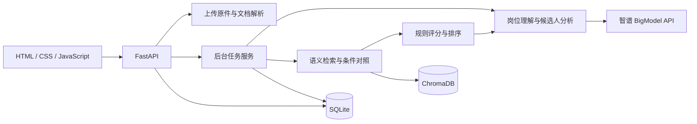

# 架构与数据流

## 系统分层

## 上传链路

格式与大小检查 → 内容指纹检查 → PDF 文字层或文本读取 → 简历元数据提取与校验 → 向量写入 → 原件及业务记录保存。

完全相同的已入库文件复用解析结果；旧记录缺失原件时可补存。新文件处理依赖模型响应，后续步骤失败不代表之前的 API 调用免费。

## 筛选链路

岗位文本与资料库、模型配置生成任务指纹 → 检查可复用任务 → 解析岗位 → 向量召回 → 读取有效业务记录 → 宽松条件对照 → 规则评分与排序 → 逐人生成报告 → 保存结果与用量。

默认向量召回 10 条；小型资料库最多 10 条时补齐当前有效记录进行比较。条件不符或缺失记录为提示，不直接清空候选人。该策略适合当前本地小型资料库，不代表大规模检索效果已评测。

模型分析失败时，`local_report.py` 根据已有数据生成规则报告。页面中的来源说明用于区分模型分析和本地分析。

## 核心文件

| 文件 | 职责 |
| --- | --- |
| `local_app.py` | 加载配置、部署状态与密钥检查 |
| `app/api/routes.py` | 上传、筛选计算、资料及回收站接口 |
| `app/workbench.py` | 单进程后台任务、状态和历史 |
| `app/persistence.py` | SQLite 业务记录和任务持久化 |
| `app/usage.py` | 模型用量和配置单价估算 |
| `app/core/relaxed_matching.py` | 宽松候选人选择与条件提示 |
| `app/core/scorer.py` | 六维规则评分 |
| `app/core/analyzer.py` | 模型报告编排和失败处理 |
| `app/core/local_report.py` | 基于已有证据生成本地规则报告 |
| `app/core/pdf_export.py` | 中文文字重建版 PDF |

## 数据存储

- `data/workbench.sqlite3`：简历元数据、提取文字、岗位、任务、结果、回收站及用量。
- `data/files/`：按内部标识保存的上传原件。
- `chroma_db/`：向量索引。
- `cache/`：解析及模型提取缓存。

SQLite 和向量库不是同一个事务，发生异常时可能需要核对两者一致性。备份应先停止服务，再一起备份业务数据、原件、向量库及配置。

## 使用范围

后台执行器属于当前服务进程，不是独立分布式任务队列。服务重启会将未完成任务标记为中断，不自动重试。当前没有账号和权限隔离；不要直接将本地演示配置当作多人生产配置。
